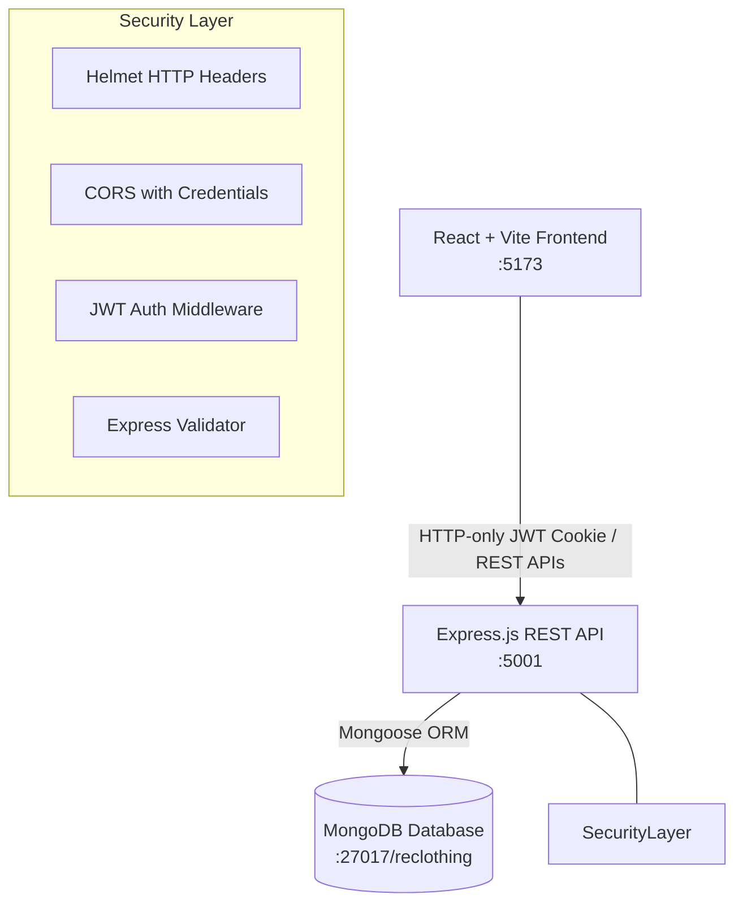
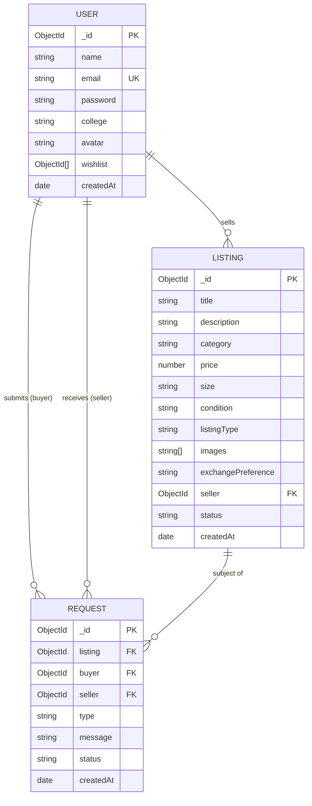

# ReClothing — Campus Thrift & Clothing Exchange Marketplace

> **"Wear More. Waste Less."**  
> A peer-to-peer campus circular fashion marketplace built on the MERN stack (MongoDB, Express, React, Node.js) for college students to buy, sell, and exchange pre-loved clothing, shoes, bags, and textbooks.

---

## 📖 Table of Contents
1. [Project Overview](#-project-overview)
2. [Problem Statement & Proposed Solution](#-problem-statement--proposed-solution)
3. [Key Features](#-key-features)
4. [Technology Stack](#-technology-stack)
5. [System Architecture](#-system-architecture)
6. [Folder Structure](#-folder-structure)
7. [Prerequisites](#-prerequisites)
8. [Installation & Setup](#-installation--setup)
9. [Environment Variables](#-environment-variables)
10. [Database Seeding & Demo Accounts](#-database-seeding--demo-accounts)
11. [Running the Application](#-running-the-application)
12. [REST API Documentation](#-rest-api-documentation)
13. [Database Schema Overview](#-database-schema-overview)
14. [Security & Authentication](#-security--authentication)
15. [Testing & Verification](#-testing--verification)
16. [Known Limitations & Future Scope](#-known-limitations--future-scope)

---

## 🌟 Project Overview

Demo Video Link : [https://drive.google.com/file/d/1A4YrX9F0bX9eLzdVdUElOYeOaaKZQsdC/view?usp=sharing]

**ReClothing** is a campus-focused circular economy web application designed to solve student wardrobe waste. College students frequently accumulate garments, winter wear, backpacks, sneakers, and course textbooks that go unused after a semester. ReClothing provides a verified campus marketplace where students can discover affordable secondhand goods, list their pre-loved items for cash or trade, and schedule safe, localized on-campus meetups.

---

## 🎯 Problem Statement & Proposed Solution

### The Problem
* **Fast Fashion & Wardrobe Waste:** Fast fashion accounts for 10% of global carbon emissions. Students discard lightly worn clothes due to dorm downsizing or seasonal shifts.
* **Campus Cost Barriers:** Purchasing brand-new textbooks, winter coats, and formal attire each semester strains student budgets.
* **Inconvenient Resale Channels:** General marketplaces (e.g., eBay, Facebook Marketplace) involve expensive shipping fees, impersonal interactions, or untrusted strangers.

### The Solution
ReClothing connects verified college students within their specific college community:
* **Zero Transaction Fees:** Direct student-to-student transactions with zero platform commissions.
* **Dual Listing Types:** Support for both cash purchases (*For Sale*) and direct swaps (*For Exchange* with custom trade preferences).
* **Safe Campus Meetups:** Encourages meeting in well-lit public campus locations (e.g., student unions, campus libraries).
* **Real Environmental Impact:** Promotes circular consumption, extending clothing lifecycles and diverting textiles from landfills.

---

## 🚀 Key Features

* **Visual Landing Page:** Editorial fashion aesthetics, dynamic featured drops fetched from MongoDB, campus sustainability metrics, and a "How It Works" guide.
* **Real-Time Catalog & Search:** 
  * Keyword search matching listing titles and descriptions.
  * Multi-dimensional filtering by Category (*Clothing, Shoes, Accessories, Bags, Books, Other*), Listing Type (*For Sale, For Exchange*), Condition (*New, Like New, Good, Fair*), Size (*XS to XXL, One Size*), and Price range.
  * Sorting by Newest, Price (Low to High), and Price (High to Low).
* **Listing Management (CRUD):** Authenticated students can create, edit, update status (*active, reserved, sold, exchanged*), and delete listings with confirmation modals.
* **Campus Trade Proposal System:**
  * **Purchase Requests:** Express buying interest and propose meeting spot/time.
  * **Exchange Proposals:** Propose item swaps matching seller preferences.
  * **Seller Decision Workflow:** Sellers review incoming requests to Accept or Decline.
  * **Atomic State Updates:** Accepting a request updates listing status to `reserved` or `exchanged` and declines competing pending requests.
* **Student Dashboard & Analytics:** Dynamic Recharts visualizations calculating live category distributions, inquiry status breakdowns, and recent platform trade activity from MongoDB aggregations.
* **Personal Wishlist & Profile:** Save favorite items with one click and update profile details.

---

## 💻 Technology Stack

### Frontend
* **React 18** (Functional components, custom hooks, Context API)
* **Vite 5** (Fast ES module dev server and production builder)
* **Tailwind CSS 3** (Custom editorial palette: Warm Ivory `#F8F7F2`, Forest Green `#234D3C`, Charcoal `#20251F`)
* **React Router DOM 6** (Client-side routing with protected route wrappers)
* **Axios** (Centralized API client with `withCredentials: true`)
* **Lucide React** (Modern iconography)
* **React Hot Toast** (User-friendly toast alerts)
* **Recharts 2** (Interactive data visualization charts)

### Backend
* **Node.js** & **Express.js** (Modular REST API architecture)
* **MongoDB** & **Mongoose 8** (Document database with schema validation and indexing)
* **JWT (JSON Web Tokens)** (Stored in secure, `httpOnly` cookies)
* **bcryptjs** (Salted password hashing)
* **cookie-parser** (Parsing incoming cookie tokens)
* **CORS** (Whitelisting frontend origin with credentials)
* **Helmet** (HTTP security header protection)
* **express-validator** (Request input validation and sanitization)

---

## 🏛 System Architecture



---

## 📂 Folder Structure

```text
EndTermProject/
├── client/                     # React + Vite Frontend
│   ├── public/
│   ├── src/
│   │   ├── api/                # Centralized Axios API services
│   │   │   ├── authApi.js
│   │   │   ├── axios.js
│   │   │   ├── listingApi.js
│   │   │   ├── requestApi.js
│   │   │   └── userApi.js
│   │   ├── components/         # Reusable UI Components
│   │   │   ├── ConfirmModal.jsx
│   │   │   ├── EmptyState.jsx
│   │   │   ├── ErrorMessage.jsx
│   │   │   ├── Footer.jsx
│   │   │   ├── LoadingSpinner.jsx
│   │   │   ├── Navbar.jsx
│   │   │   ├── ProductCard.jsx
│   │   │   ├── ProductGrid.jsx
│   │   │   ├── ProtectedRoute.jsx
│   │   │   └── RequestModal.jsx
│   │   ├── context/            # Authentication Context
│   │   │   └── AuthContext.jsx
│   │   ├── layouts/            # Main Layout with Toaster
│   │   │   └── MainLayout.jsx
│   │   ├── pages/              # Application Routes
│   │   │   ├── CreateListing.jsx
│   │   │   ├── Dashboard.jsx
│   │   │   ├── EditListing.jsx
│   │   │   ├── Home.jsx
│   │   │   ├── ListingDetails.jsx
│   │   │   ├── Login.jsx
│   │   │   ├── Marketplace.jsx
│   │   │   ├── MyListings.jsx
│   │   │   ├── MyRequests.jsx
│   │   │   ├── NotFound.jsx
│   │   │   ├── Profile.jsx
│   │   │   └── Register.jsx
│   │   ├── utils/              # Formatting Utilities
│   │   │   ├── formatCurrency.js
│   │   │   └── formatDate.js
│   │   ├── App.jsx
│   │   ├── index.css
│   │   └── main.jsx
│   ├── package.json
│   ├── tailwind.config.js
│   └── vite.config.js
├── server/                     # Express.js Backend
│   ├── scripts/
│   │   └── seed.js             # Realistic MongoDB database seeder
│   ├── src/
│   │   ├── config/
│   │   │   └── db.js           # Mongoose MongoDB connection
│   │   ├── controllers/        # Request Handlers
│   │   │   ├── authController.js
│   │   │   ├── dashboardController.js
│   │   │   ├── listingController.js
│   │   │   ├── requestController.js
│   │   │   └── userController.js
│   │   ├── middleware/         # Security & Error Handling
│   │   │   ├── authMiddleware.js
│   │   │   ├── errorMiddleware.js
│   │   │   └── validateRequest.js
│   │   ├── models/             # Mongoose Schemas
│   │   │   ├── Listing.js
│   │   │   ├── Request.js
│   │   │   └── User.js
│   │   ├── routes/             # REST Route Definitions
│   │   │   ├── authRoutes.js
│   │   │   ├── dashboardRoutes.js
│   │   │   ├── listingRoutes.js
│   │   │   ├── requestRoutes.js
│   │   │   └── userRoutes.js
│   │   ├── utils/
│   │   │   └── asyncHandler.js
│   │   ├── app.js              # Express app configuration
│   │   └── server.js           # Server bootstrap & listener
│   ├── package.json
│   └── .env.example
├── docs/                       # Comprehensive Academic Documentation
│   └── PROJECT_REPORT.md
├── .env.example
├── .gitignore
├── package.json                # Root package with concurrently
└── README.md
```

---

## ⚙️ Prerequisites

* **Node.js**: `v18.0.0` or higher (verified on Node `v26.12.1`)
* **npm**: `v9.0.0` or higher
* **MongoDB**: A running local MongoDB instance on port `27017` or a MongoDB Atlas connection URI.

---

## 📥 Installation & Setup

1. **Clone the repository:**
   ```bash
   git clone <repository-url>
   cd EndTermProject
   ```

2. **Install all dependencies (Root, Server, Client):**
   ```bash
   npm run install:all
   ```
   *Or install individually:*
   ```bash
   # In root
   npm install
   # In server
   cd server && npm install
   # In client
   cd ../client && npm install
   ```

---

## 🔐 Environment Variables

### Backend (`server/.env`)
Create a file named `.env` in the `server` directory:
```env
PORT=5001
NODE_ENV=development
MONGODB_URI=your_mongodb_connection_uri
JWT_SECRET=your_jwt_secret_key
CLIENT_URL=http://localhost:5173
```
*(Note: Port 5001 is used by default because macOS ControlCenter occupies port 5000).*

### Frontend (`client/.env`)
Create a file named `.env` in the `client` directory:
```env
VITE_API_URL=http://localhost:5001/api
```

---

## 🌱 Database Seeding & Demo Accounts

ReClothing includes an automated seed script that populates realistic campus users, 14 diverse listings across all categories, and sample trade requests.

To seed the database:
```bash
npm run seed
```

### Pre-Configured Demo Accounts (Password: `password123`)
| Name | Email | College | Role / Sample Data |
| :--- | :--- | :--- | :--- |
| **Elena Rostova** | `elena@campus.edu` | Stanford University | **Seller** (Denim jacket, Combat boots, Textbooks) |
| **Marcus Chen** | `marcus@campus.edu` | UC Berkeley | **Student** (Nike AF1s, Ray-Ban sunglasses) |
| **Sarah Jenkins** | `sarah@campus.edu` | Columbia University | **Student** (Knit Wool Sweater, Leather Tote) |
| **Dev Patel** | `dev@campus.edu` | NYU Stern | **Buyer** (Has active trade requests) |

*(Quick-login buttons are also provided on the `/login` page for fast evaluation)*.

---

## 🏃 Running the Application

### Option A: Run Both Together (Recommended)
From the root project directory:
```bash
npm run dev
```
* Concurrently starts the Express backend on `http://localhost:5001`
* Starts the Vite React frontend on `http://localhost:5173`

### Option B: Run Individually
**Terminal 1 (Backend):**
```bash
cd server
npm run dev
```

**Terminal 2 (Frontend):**
```bash
cd client
npm run dev
```

Open your browser at `http://localhost:5173`.

---

## 📡 REST API Documentation

### Authentication (`/api/auth`)
| Method | Endpoint | Access | Description |
| :--- | :--- | :--- | :--- |
| `POST` | `/api/auth/register` | Public | Register student, hashes password, sets cookie |
| `POST` | `/api/auth/login` | Public | Verify credentials, issues HTTP-only JWT |
| `POST` | `/api/auth/logout` | Public | Clears authentication cookie |
| `GET` | `/api/auth/me` | Private | Returns currently authenticated user session |

### Listings (`/api/listings`)
| Method | Endpoint | Access | Description |
| :--- | :--- | :--- | :--- |
| `GET` | `/api/listings` | Public | Search, filter, sort & paginate items |
| `GET` | `/api/listings/featured` | Public | Get recent 8 active listings for homepage |
| `GET` | `/api/listings/:id` | Public | Get single listing with seller info |
| `POST` | `/api/listings` | Private | Create new listing (ownership bound to JWT) |
| `PUT` | `/api/listings/:id` | Private | Update listing (owner only) |
| `DELETE`| `/api/listings/:id` | Private | Delete listing and clean associated requests |
| `GET` | `/api/listings/mine` | Private | Get authenticated user's listings |

### Requests (`/api/requests`)
| Method | Endpoint | Access | Description |
| :--- | :--- | :--- | :--- |
| `POST` | `/api/requests` | Private | Submit purchase or exchange request |
| `GET` | `/api/requests/sent` | Private | Retrieve requests sent by user |
| `GET` | `/api/requests/received`| Private | Retrieve incoming requests for seller's items |
| `PATCH`| `/api/requests/:id/accept` | Private | Seller accepts request; reserves item atomically |
| `PATCH`| `/api/requests/:id/reject` | Private | Seller rejects pending request |
| `PATCH`| `/api/requests/:id/cancel` | Private | Buyer cancels their pending request |

### Users & Wishlist (`/api/users`)
| Method | Endpoint | Access | Description |
| :--- | :--- | :--- | :--- |
| `GET` | `/api/users/me` | Private | User profile & activity stats |
| `PATCH`| `/api/users/me` | Private | Update name, college, avatar |
| `GET` | `/api/users/me/wishlist`| Private | Get user's saved wishlist items |
| `POST` | `/api/users/me/wishlist/:id` | Private | Save item to wishlist |
| `DELETE`| `/api/users/me/wishlist/:id`| Private | Remove item from wishlist |

### Dashboard (`/api/dashboard`)
| Method | Endpoint | Access | Description |
| :--- | :--- | :--- | :--- |
| `GET` | `/api/dashboard/stats` | Private | MongoDB aggregations for KPIs & charts |
| `GET` | `/api/dashboard/activity` | Private | Recent listings & trade inquiry feeds |

---

## 🗄 Database Schema Overview



---

## 🛡 Security & Authentication

1. **HTTP-Only Cookies:** JWT tokens are issued upon authentication and saved in `httpOnly`, `sameSite: lax` cookies. This mitigates Cross-Site Scripting (XSS) token theft compared to `localStorage`.
2. **Server-Enforced Ownership:** Seller ID is never accepted from client form payloads; it is derived exclusively from the verified JWT payload (`req.user._id`).
3. **Password Security:** Passwords hashed with `bcryptjs` using a salt work factor of 10. Passwords are never returned in JSON queries (`select: false`).
4. **Input Sanitization & Escaping:** Regex searches in query strings are escaped against ReDoS and regex injection. Numbers and enumerations are validated via `express-validator`.
5. **CORS & Helmet:** Restricts origin access to `http://localhost:5173` with credentials enabled and enforces security headers.

---

## 🧪 Testing & Verification

The application features full end-to-end verification covering:
* User registration and duplicate email rejection.
* Authentication, credential validation, and cookie persistence.
* Creating, editing, and deleting listings with owner checks.
* Searching by keyword, filtering by category/condition/price, and sorting.
* Buyer request submission (with prevention against requesting one's own listing).
* Seller request acceptance with atomic listing status update (`active` ➔ `reserved`).
* Dashboard live aggregations from MongoDB.

---

## 🚀 Known Limitations & Future Scope

### Current Scope & Limitations
* **Local Image URLs:** Images currently support valid public URLs (e.g. Unsplash, Cloudinary, Imgur) to ensure high reliability across local demonstration environments.
* **Non-Payment Workflow:** As per the project design, ReClothing deliberately does not handle real card payments. Purchase requests indicate firm interest for on-campus cash/Venmo handoffs.

### Future Scope
* **Direct Real-Time Chat:** WebSockets / Socket.io for instant campus messaging between buyer and seller.
* **Campus Map Integration:** Interactive campus map showing pickup zones (e.g., Student Center, Library).
* **Multi-Campus Filtering:** Filter products by specific college campuses.

---

## 👥 Authors
* Developed for **College End-Term Capstone Project**
* ReClothing Engineering Team
