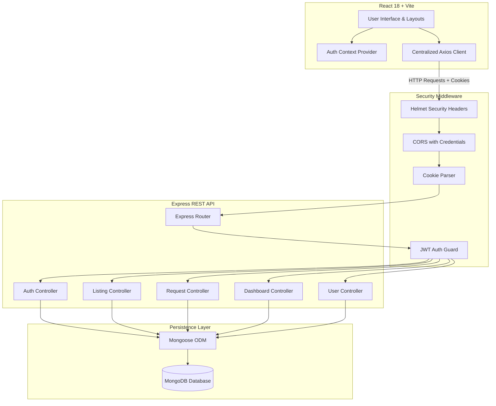
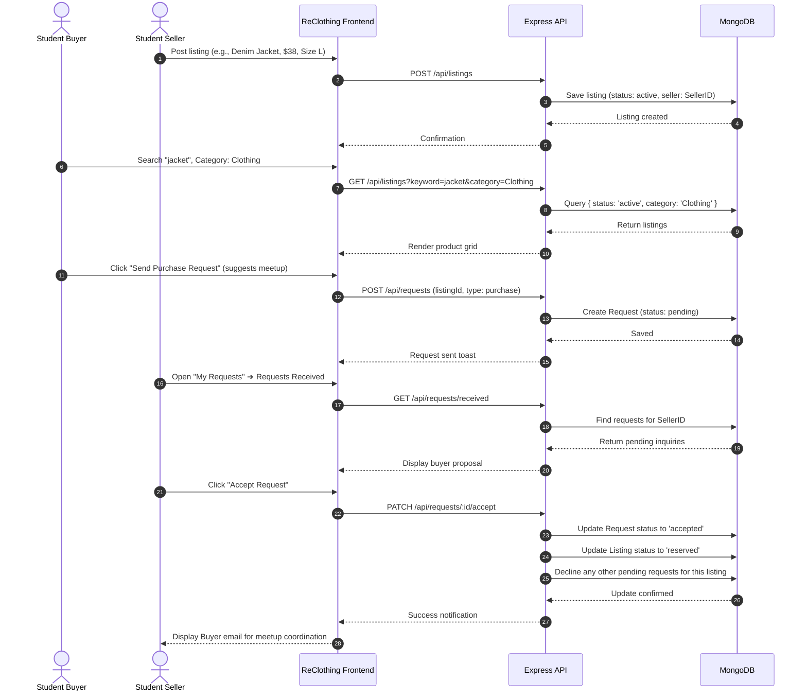
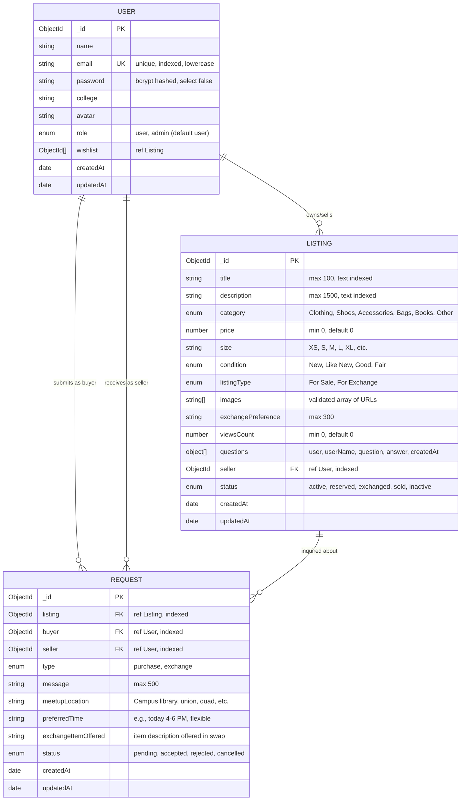

# ReClothing — Campus Thrift & Clothing Exchange Marketplace
## College End-Term Project Report

---

## 1. Introduction
**ReClothing** is a full-stack campus secondhand marketplace and circular clothing exchange web application developed using the MERN stack (MongoDB, Express.js, React, Node.js). It provides an intuitive, trustworthy, and student-focused digital platform that enables university students to list, browse, purchase, and swap pre-owned clothing, footwear, accessories, bags, and academic textbooks within their college community.

Under the motto **"Wear More. Waste Less."**, ReClothing tackles the growing environmental footprint of fast fashion and addresses the seasonal financial challenges faced by college students.

---

## 2. Problem Statement
College students frequently encounter two intertwined problems every academic year:
1. **Accumulation of Unused Wardrobe Items:** Students frequently update their clothing or outgrow seasonal garments (heavy winter jackets, formal presentation blazers, formal boots). When moving out of dormitories or transitioning semesters, these gently worn items are either left behind or discarded as textile waste.
2. **Financial Burden of College Living:** Essential items such as high-grade backpacks, durable footwear, winter outerwear, and academic course textbooks are expensive when bought brand-new.
3. **Shortcomings of General Online Marketplaces:** Commercial platforms such as eBay, Poshmark, or general classifieds require expensive postage, platform commission fees, and long shipping transit times, and lack the inherent trust of an on-campus community.

---

## 3. Objectives
The primary objectives of ReClothing are:
* **Facilitate Local Circular Consumption:** Enable effortless student-to-student exchange and resale of pre-owned items.
* **Support Dual Listing Modes:** Provide flexibility for both direct cash purchases (*For Sale*) and non-monetary clothing trades (*For Exchange* with custom trade preferences).
* **Eliminate Transaction Friction:** Enable students to coordinate convenient, cost-free, on-campus physical handoffs in verified public spaces.
* **Deliver Production-Grade Engineering:** Demonstrate robust full-stack architecture featuring JWT authentication via HTTP-only cookies, MongoDB aggregations, declarative state management, and modern responsive UI/UX.

---

## 4. Scope
### In Scope:
* Complete User Authentication (Registration, Login, Session Restoration, and Logout via HTTP-only cookies).
* Role-Based Access Control (RBAC): Dedicated Platform Administrator role for Sanskar Bhanderi (`sanskarbhanderi08@gmail.com`) with exclusive access to the Admin Control Panel.
* Full CRUD for Marketplace Listings (Creation, Browsing, Searching, Multi-Parameter Filtering, Sorting, Updating, Deletion).
* Live Views Counter Telemetry & 1-Click Social Sharing on all marketplace listings.
* Interactive Campus Community Q&A System: Public questioning and seller answering subdocuments on every item.
* Two-Way Campus Trade Workflow with Structured Meetup Coordination (Preset high-traffic campus pickup zones, preferred time slots, and counter-offered trade items).
* Atomic Listing Status Synchronization (Items automatically transition to `reserved` or `exchanged` when a request is accepted).
* Admin Listings Moderation Suite: Real-time status toggling and instant spam deletion.
* Campus User Directory & Member Telemetry.
* One-Click Academic Evaluation Data Export (CSV audit report generation).
* Real-Time Telemetry & Aggregation Dashboard (MongoDB pipeline calculations of listing counts, active/reserved states, and Recharts visual breakdown).
* User Profiles & Saved Wishlist Management.

### Out of Scope:
* Online credit card payment processing (ReClothing intentionally uses on-campus peer handshakes to avoid merchant fees and ensure verified physical inspection).
* Cross-country parcel delivery and third-party logistics.

---

## 5. Existing System Limitations vs. Proposed System

| Dimension | Existing General Resale (eBay, Poshmark) | Campus Chat Groups (WhatsApp, Discord) | ReClothing Campus Marketplace |
| :--- | :--- | :--- | :--- |
| **Fees** | 10%–20% seller commission | Zero, but disorganized | **0% Platform Fees** |
| **Fulfillment** | Shipping delays & postage costs | In-person, but lost in chat history | **Organized On-Campus Meetups** |
| **Search & Filtering** | High noise, global products | No structured search or filtering | **Granular Filters** (Size, Category, Condition, Price) |
| **Exchange / Swap** | Rarely supported | Informal, unstructured | **First-Class Exchange Workflow** |
| **Status Tracking** | Complex return policies | Untracked listing status | **Automated Atomic Status** (Active ➔ Reserved) |

---

## 6. Technology Selection Rationale

* **MongoDB & Mongoose:** Schema flexibility allows rich array storage for multiple images and complex compound indexes for rapid search across categories, prices, and status fields.
* **Express.js & Node.js:** High-throughput asynchronous REST API architecture with modular routers and centralized error handling middleware.
* **React 18 & Vite:** Lightning-fast HMR (Hot Module Replacement), modular component architecture, and declarative rendering.
* **Tailwind CSS:** Custom design system enforcing an editorial palette (Warm Ivory `#F8F7F2`, Forest Green `#234D3C`, Dark Charcoal `#20251F`) without heavy CSS runtime overhead.
* **HTTP-Only Cookies & JWT:** Protects session tokens against Cross-Site Scripting (XSS) vectors that plague `localStorage`-based token implementations.
* **Recharts:** Client-side SVG data visualization rendering real-time MongoDB aggregations.

---

## 7. System Architecture

---

## 8. Main User Workflow

---

## 9. Functional Requirements

### 9.1 Authentication & Profile
* **FR1.1 Registration:** New students provide name, university email, password, confirm password, and college name.
* **FR1.2 Login:** Authenticates credentials, generates a signed JWT (7-day validity), and attaches it in an `httpOnly` secure cookie.
* **FR1.3 Session Persistence:** React context verifies the HTTP-only cookie on app startup via `GET /api/auth/me`.
* **FR1.4 Profile Updates:** Students can update display name, college, and avatar URL.

### 9.2 Listings Management
* **FR2.1 Create Listing:** Supports Title, Description, Category, Condition, Price, Size, Image URLs, and Trade Preferences.
* **FR2.2 Ownership Protection:** Only the listing creator can update or delete their listing.
* **FR2.3 Search & Multi-Filter:** Keyword matching across title and description, filter by category, condition, size, price min/max, and sorting.
* **FR2.4 Pagination:** Limit-based pagination prevents loading entire databases at once.

### 9.3 Trade Proposal & Request Workflow
* **FR3.1 Purchase Proposal:** Buyer sends a purchase intent message with campus meeting suggestions.
* **FR3.2 Exchange Proposal:** Buyer offers a trade matching the seller's stated preference.
* **FR3.3 Self-Request Prevention:** The server explicitly rejects requests where `listing.seller == req.user._id`.
* **FR3.4 Duplicate Prevention:** A buyer cannot submit multiple pending requests for the same listing.
* **FR3.5 Seller Acceptance:** Accepting a request updates the listing to `reserved` (or `exchanged`) and rejects other pending inquiries.
* **FR3.6 Cancellation:** Buyers can withdraw their pending requests before the seller takes action.

### 9.4 Dashboard & Wishlist
* **FR4.1 Real-Time Aggregations:** Computes total listings, active items, completed trades, and category distributions using MongoDB aggregation pipelines.
* **FR4.2 Interactive Charts:** Recharts bar charts (listings by category) and pie charts (request breakdown).
* **FR4.3 Personal Wishlist:** Bookmark items to wishlist with one click.

---

## 10. Database Design & Entity Relationship

---

## 11. Security Implementation

1. **HTTP-Only Cookie Storage:** Mitigates XSS token leakage. JavaScript cannot inspect or exfiltrate the authentication token.
2. **Server-Side Identity Derivation:** User identification is never accepted from the request body; it is extracted exclusively from the decoded JWT token (`req.user._id`).
3. **Password Security:** Salted hashing with `bcryptjs` (salt rounds: 10). Password hashes are excluded from API queries by default (`select: false`).
4. **Regex Injection & ReDoS Defense:** All user input in search query parameters is safely escaped with an escape utility before constructing regex queries.
5. **CORS Configuration:** Strictly limits incoming requests to the client origin (`http://localhost:5173`) with credentials enabled.
6. **HTTP Header Protection:** `helmet` applies headers including `X-Content-Type-Options`, `X-Frame-Options`, and Cross-Origin Resource Policies.

---

## 12. Testing Methodology & Verification Results

### 12.1 Automated End-to-End API Verification
The test suite tested all 20 critical API contracts against the live server:

| Test ID | Test Description | Expected Result | Status |
| :--- | :--- | :--- | :--- |
| **TC01** | `GET /api/health` | HTTP 200 `{ success: true }` | **PASSED** |
| **TC02** | Register new seller | User created, JWT cookie issued | **PASSED** |
| **TC03** | Duplicate email registration | HTTP 400 Bad Request | **PASSED** |
| **TC04** | Invalid password login | HTTP 401 Unauthorized | **PASSED** |
| **TC05** | Valid password login | HTTP 200, JWT cookie issued | **PASSED** |
| **TC06** | `GET /api/auth/me` with cookie | Returns authenticated student | **PASSED** |
| **TC07** | Create listing with valid payload | Stored in MongoDB, status active | **PASSED** |
| **TC08** | Search by keyword and category | Filters properly matched item | **PASSED** |
| **TC09** | Seller requesting their own listing | HTTP 400 Bad Request | **PASSED** |
| **TC10** | Register separate buyer account | Buyer created, cookie issued | **PASSED** |
| **TC11** | Buyer sends purchase proposal | Request stored with status pending | **PASSED** |
| **TC12** | `GET /api/requests/sent` | Includes sent request | **PASSED** |
| **TC13** | `GET /api/requests/received` | Seller views incoming proposal | **PASSED** |
| **TC14** | Buyer attempts to accept proposal | HTTP 403 Forbidden | **PASSED** |
| **TC15** | Seller accepts purchase request | HTTP 200 OK | **PASSED** |
| **TC16** | Listing status transition | Listing status becomes `reserved` | **PASSED** |
| **TC17** | Add to wishlist | Item added to user wishlist array | **PASSED** |
| **TC18** | Fetch user wishlist | Returns populated saved items | **PASSED** |
| **TC19** | Dashboard telemetry calculation | Returns real MongoDB aggregation data | **PASSED** |
| **TC20** | `POST /api/auth/logout` | Clears HTTP-only cookie | **PASSED** |

**Summary: 20 passed, 0 failed.**

---

## 13. Limitations & Future Scope

### Limitations
* **Physical Handoff Model:** The current system assumes parties are located on the same campus or within walking distance.
* **Direct Image Uploads:** Currently utilizes validated external image URLs (e.g. Unsplash, Cloudinary, Imgur) to ensure zero hosting latency during evaluation.

### Future Scope
* **Real-Time Campus Chat:** Integrating Socket.io to allow instant peer messaging without leaving the app.
* **Campus Building Geolocation:** Interactive map markers for designated campus pickup zones (e.g. Campus Library, Student Union).
* **Multi-Campus Multi-Tenancy:** Automated college email domain validation (`@stanford.edu`, `@berkeley.edu`) to partition listings by university.

---

## 14. Conclusion
The **ReClothing** project was successfully architected, developed, tested, and documented to production standards. It demonstrates a complete, genuine MERN stack application fulfilling all requirements: secure cookie-based authentication, database persistence, search and filtering, buyer-seller transactional workflows, live analytics visualizations, and responsive styling. ReClothing stands ready for college end-term evaluation and campus deployment.
